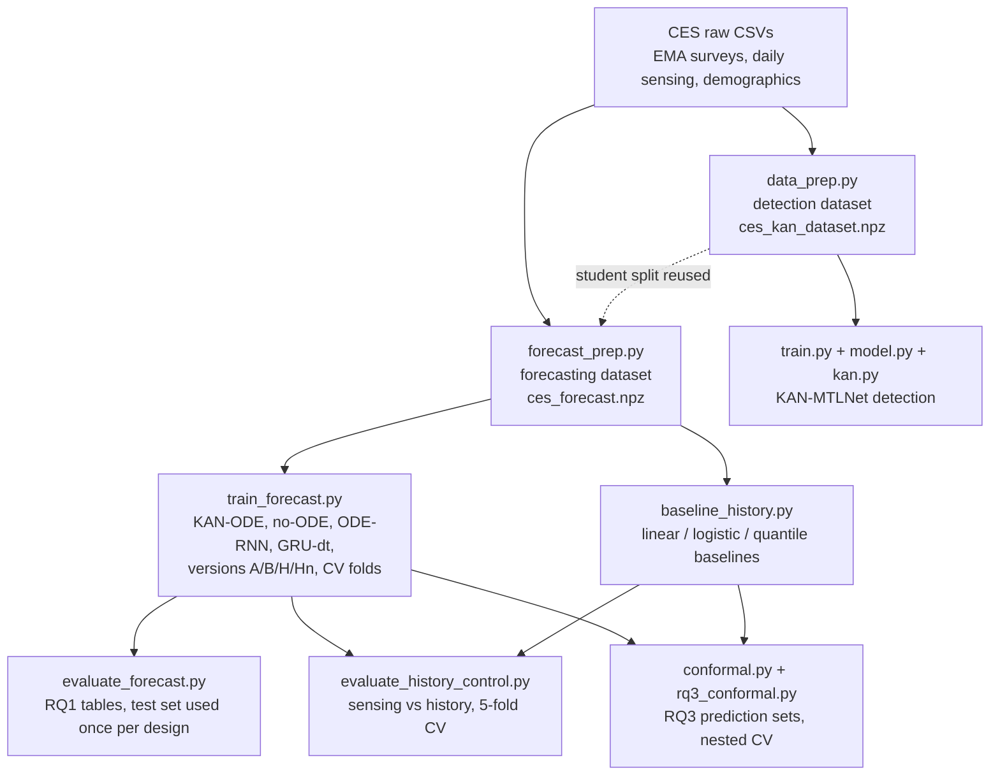

# 00 · Overview: what this project is and how it fits together

> Read this first. Every later file goes deeper into one part. Numbers in this guide come from
> the result files in `runs/` (not in git) and from `README.md` / `CLAUDE.md`; each number says
> where it comes from.

## 1. The problem in one paragraph

University students often develop depression or anxiety symptoms, and these symptoms change week
to week. If we could **forecast** who is likely to feel worse in the next weeks, a counselling
service could check in earlier. This project asks whether a student's **own past survey answers**
and **phone data** (how much they move, where they go, how they sleep, how much they use the
phone) can forecast their future depression and anxiety **screening scores**, and how certain such
forecasts are. It is a **research tool, not a clinical system**: the scores are short screening
questionnaires, never a diagnosis.

## 2. Key ideas you need from the start

### Digital phenotyping
**Why:** clinicians normally see a student only occasionally; a phone is with the student every day.
**What:** "digital phenotyping" means measuring behaviour from everyday digital traces — e.g. daily
step-like activity, distance travelled, time at home, sleep start time, number of phone unlocks.
**Everyday example:** a fitness app that notices you walked much less this week than usual.
**Common mistake:** assuming that because a behaviour is *measured*, it *predicts* mental health.
This project tests that assumption — and in our data the answer was mostly "no" (see §5).

### Longitudinal data
**Why:** symptoms change over time; one snapshot cannot show change.
**What:** the same student is measured many times (here: a short survey roughly every 5 days, plus
daily phone data, over months to years).
**Consequence you must remember everywhere:** the many surveys of one student are **not
independent**. A student who answers 300 surveys must not count as 300 separate people. That is
why every split, every confidence interval and the RQ3 calibration are done **by student**.

### Screening scores used here (details in `01_data.md`)
- **PHQ-2** (depression) and **GAD-2** (anxiety): each the sum of two items scored 0–3, so 0–6.
- **Screen-positive** = score ≥ 3 (a standard cut-off). Positive means "worth a closer look",
  not "has depression".

## 3. The research questions

| RQ | Question | Status |
|---|---|---|
| RQ1 | Can a **KAN-ODE** forecast future PHQ-2 / GAD-2 scores (1, 2, 4, 8 weeks ahead) better than **persistence** ("future = today") and better than the **same KAN without the ODE**? | Done. Answer: **no** (two ODE designs tested) |
| (control) | Do the models' ranking gains come from **phone sensing** or from **symptom history**? | Done. Answer: **symptom history**; sensing adds nothing measurable |
| RQ2 | Which behavioural factors are associated with future worsening? | **Not done.** Supervisor suggested an ablation study instead (planned, not started) |
| RQ3 | Can **conformal prediction** give reliable prediction ranges, overall and within gender / race groups? | Done. Answer: **yes, with student-level calibration** |

Before these, the project reproduced a published model (**KAN-MTLNet**, Ali, Ni & Kundur 2025)
in a *detection* setting (today's status from the last 60 days of phone data). That gave a weak
result (test macro AUROC 0.583, from `README.md`; the result file itself is not on this laptop,
see `07_limitations_and_viva.md`).

## 4. How the whole pipeline fits together



ASCII version of the data flow for one forecast:

```
 day t0-60 ............................ day t0-1 | day t0 (survey) | t0+7  t0+14  t0+28  t0+56
 [ 60 days of phone sensing, X (60 x 22) ]        [ today's scores ] [ targets: future PHQ-2 / GAD-2 ]
 [ engineered summaries E (34) ]                  [ history H (6)  ]
 [ static: gender, race, iPhone share S (10) ]
                         \        |        /
                          model (KAN / KAN-ODE)  --->  predicted scores + screen-positive logits
                                                         at 1, 2, 4, 8 weeks
                                                         --> conformal sets (RQ3)
```

## 5. The headline results (details in `04_rq1_results.md` and `06_rq3_implementation_and_results.md`)

1. **RQ1 – the ODE does not help.** Variant A (ODE after the encoder) and variant C (ODE inside the
   encoder) both fail the pre-registered rule (`runs/final/eval_test/rq1_table.md`,
   `runs/variantC/final/eval_test/rq1_table.md`).
2. **No model beats persistence on score error (MAE).** Persistence test MAE (averaged over the two
   scores) is 0.633 at 1 week; the best KAN is 0.739 (`runs/final/eval_test/rq1_table.md`).
3. **Models with symptom history rank risk better than persistence.** E.g. onset AUC-PR about
   0.23–0.27 vs 0.12–0.17 for persistence (same file).
4. **That gain comes from symptom history, not phone sensing**, and a plain linear / logistic model
   on history does as well as the KAN (`runs/historyctl/eval/table.md`).
5. **RQ3 – conformal prediction works if calibrated per student**: all 8 models reach 90% / 80%
   coverage overall and within female, male, White and Asian students; survey-level calibration
   under-covers in 11 of 48 checks at 90% (`runs/rq3/eval/rq3_table.md`, `summary.json`). Ranges
   are wide (about 3 of the 7 possible scores) and anxiety coverage is a few points lower for female
   students under pooled calibration.

## 6. How the work was done (and why it is trustworthy)

- **Splits by student.** 149 train / 22 validation / 43 test students (`data_prep.py`).
- **Pre-registration.** Before each experiment, the plan, metrics and decision rule were written in
  `CLAUDE.md` and committed to git *before* any code or results (commits 44538b5, e9b5230, d5faf4e,
  251e369). This stops us from changing the rules after seeing results.
- **Test set used sparingly.** Used once for variant A and once for variant C, each guarded by a
  lock file (`runs/TEST_SET_USED.json`, `runs/TEST_SET_USED_variantC.json`). The history control
  and RQ3 used only cross-validation on the 170 train + validation students.
- **Negative results reported.** The ODE and sensing results are negative and are reported as such.

## 7. Timeline (from `git log`)

| Commit | What |
|---|---|
| 7dac196 | KAN-MTLNet re-implementation (detection) |
| c487236, c6cd650 | Forecasting dataset, RK4 solver, KAN-ODE models; persistence baseline |
| 8273843 | RQ1 training + evaluation; **variant A test results** |
| 44538b5 → e537253 | Variant C pre-registration → **variant C test results** |
| e9b5230 → 87e66d8 | History-only control pre-registration → results |
| d5faf4e, f9c509d, 251e369 → c618002 | RQ3 pre-registration, code, amendment → **RQ3 results** |

## 8. File map

| File | Role | Explained in |
|---|---|---|
| `data_prep.py` | detection dataset, student split, normalisation | 01 |
| `forecast_prep.py` | forecasting dataset (cutoffs, targets, history, past-survey arrays) | 01 |
| `kan.py` | `KANLinear`, `KANConv1d` | 02 |
| `model.py`, `train.py` | KAN-MTLNet, focal loss, detection training | 02 |
| `ode.py` | RK4 solver | 03 |
| `forecast_model.py` | `Encoder`, `KANDynamics`, `KANODEForecaster`, `NoODEForecaster`, `forecast_loss` | 03 |
| `odernn_model.py` | variant C: `ODERNNForecaster`, `GRUDtForecaster` | 03 |
| `train_forecast.py` | all forecasting training (fixed split, CV folds, RQ3 nested roles) | 03 |
| `evaluate_forecast.py` | RQ1 metrics, bootstrap, decision rule, test lock | 04 |
| `baseline_history.py`, `evaluate_history_control.py` | history-only control | 04 |
| `conformal.py`, `quantile_model.py`, `rq3_conformal.py` | RQ3 | 05, 06 |
| `test_*.py` | unit tests | each chapter |
| `runs/pipeline_456.py` | driver used for variant A steps 4–6 (git-ignored folder) | 03 |

## 9. Glossary (alphabetical)

| Term | Plain meaning |
|---|---|
| **α (alpha)** | allowed miss rate; α = 0.10 means a 90% target |
| **AdamW** | the optimiser used to train the networks (gradient descent with momentum and weight decay) |
| **AUC-PR** | area under the precision–recall curve; good for rare events; no-skill level = prevalence |
| **AUROC** | probability that a random positive case is ranked above a random negative one; 0.5 = coin flip |
| **B-spline** | a smooth curve built from small polynomial pieces; KAN uses them as learnable 1-D functions |
| **Bonferroni** | splitting α across several checks (α/4 per horizon) so all hold together |
| **Bootstrap (student-level)** | resample *students* with replacement many times to get a confidence interval |
| **Calibration set** | data not used for training, used to size conformal intervals |
| **CI (95%)** | range that would contain the true value in 95% of repeated studies |
| **Conformal prediction** | wraps any model to produce a set/range with a coverage guarantee |
| **Coverage** | share of cases whose true value falls inside the predicted range |
| **CQR** | conformalised quantile regression: conformal correction of predicted quantiles |
| **Cutoff (t0)** | a survey day from which we forecast forward |
| **CV / CV+** | cross-validation; CV+ is a conformal method that uses all folds' models |
| **Early stopping** | stop training when the validation loss stops improving (patience 10 epochs) |
| **EMA** | ecological momentary assessment: short surveys answered on the phone |
| **Exchangeable** | data points whose order does not matter statistically (needed by conformal) |
| **Focal loss** | a classification loss that focuses on hard / rare cases |
| **GAD-2 / PHQ-2** | 2-item anxiety / depression screening scores (0–6) |
| **Horizon** | how far ahead: 1, 2, 4 or 8 weeks |
| **KAN** | Kolmogorov–Arnold network: learnable curves on the connections instead of fixed activations |
| **KAN-ODE** | a KAN that defines how a hidden state changes over time (dz/dt = KAN(z)) |
| **Leakage** | accidentally giving the model information from the future or from test students |
| **MAE** | mean absolute error between predicted and true score |
| **Mondrian (per-group) calibration** | calibrating conformal sets separately within each group |
| **No-ODE control** | the same KAN without the time integration, to isolate the ODE's effect |
| **Onset** | becoming screen-positive at the horizon while being below 3 today (early warning) |
| **Persistence** | baseline forecast "future score = today's score" |
| **Pinball loss** | loss for training quantile predictions |
| **Pre-registration** | writing the plan and decision rule down (and committing it) before running |
| **RK4** | Runge–Kutta 4: a standard way to step an ODE forward numerically |
| **Seed** | the number that fixes the random start; different seeds = repeated runs |
| **Version A / B / H / Hn** | inputs: sensing only / sensing + history / history only / history without gender & race |
